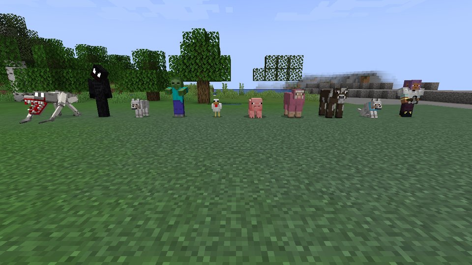
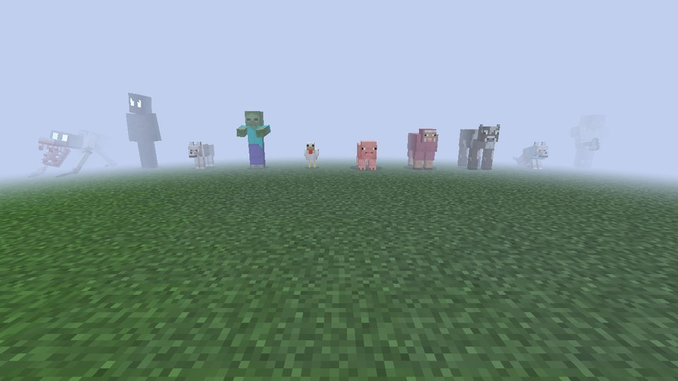
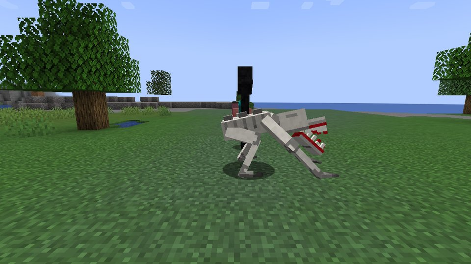
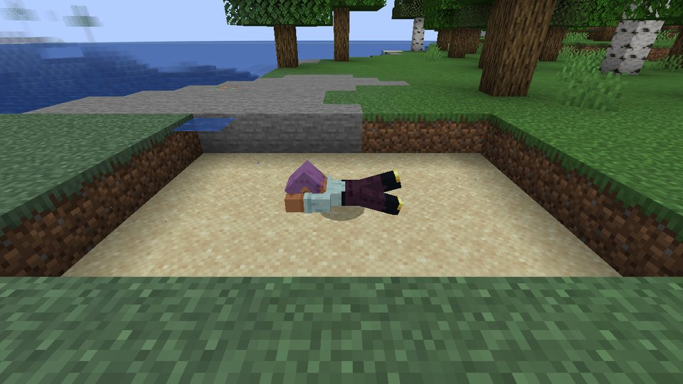
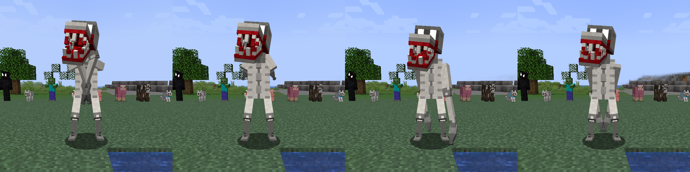
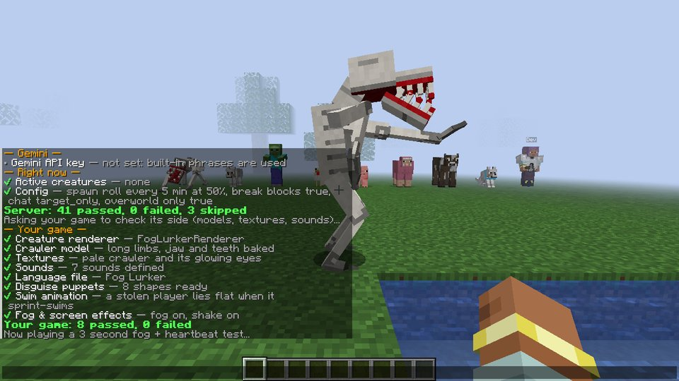
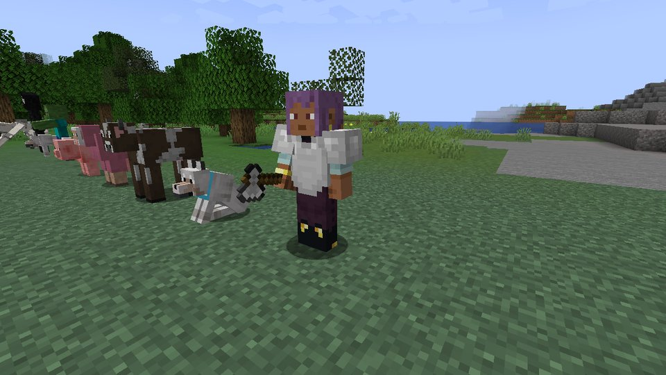

# Fog Lurker


A horror mod for **Minecraft 1.20.1 (Forge 47.x)**.

Something in the fog has been watching you play. It learns how you move and how you type. It learns what your friends sound like and what your dog is called. Then it uses all of that to lure you into the woods.


*Left to right: its pale attacking form, the watcher, a wolf, a zombie, a chicken, a pig, a sheep, a cow, **your dog** (collar and name copied) and **your friend** (skin, armour and held item copied).*

## What it does

- **It wears your friend's face.** Two of you are playing and one goes off to chop wood. The creature takes the absent player's skin, armour and held item, plus their name tag and team colour. It walks up to the other player from the direction the real friend went, so it looks like them coming back.
- **It talks like them.** It writes in chat as `<YourFriend> ...`, copying how that person types: lowercase or not, punctuation, slang, "u" for "you", and sometimes word-for-word things they really said. With a Gemini API key it holds a real conversation: ask "where are you?" and it answers in their style.
- **It sounds like them.** With [Simple Voice Chat](https://modrinth.com/plugin/simple-voice-chat) installed, it plays short snippets of the friend's real voice from where it stands. It also splices snippets into sentences they never said. This only happens for players who opted in (see [Voice snippets](#voice-snippets-opt-in)).
- **It behaves like them.** It copies their crouch-spam greeting, bunny hopping, sprint habits, idle swings, how far they stand from friends and how much they look around. All of this is learned by quietly watching each player.
- **It lures you into the woods.** It finds the thickest tree cover nearby (away from the real friend), walks you there and waits when you fall behind. If you stop following, it gets impatient in chat.
- **It hides among animals.** It can be a cow, sheep, pig, chicken, wolf or zombie in a real herd. It wanders the way the real animals around you wander (it learns that too), but stares at you a little too often and creeps closer when you look away.
- **It can be your dog.** It copies your tamed wolf's collar colour and name tag. It runs up to you, whines, then runs toward the trees and looks back, the way a dog that "found something" would.
- **It watches.** Sometimes it is just a tall black figure at the edge of your vision. Look at it too long and it is gone.
- **The fog rolls in** while it hunts you. When it reveals itself the screen shakes and you hear a heartbeat.



It never really dies. Hurt it badly enough and it melts back into the fog until next time.

## Its attacking form

When it stops pretending, its stolen shape flickers and peels away into **the crawler**. The crawler is pale and albino with gray accents. It moves on all fours, with arms long enough to reach more than a block past its shoulders and grasshopper legs whose knees sit up by its ribs. Its long jaw hangs open, showing a blood-red mouth full of teeth with blood on them, and its eyes are pure white and glow in the dark.

| Front | Side |
|---|---|
|  |  |

## You cannot hide from it on a tower or in a bunker

- **It climbs.** In its attacking form it climbs any wall it runs into, like a spider. If you pillar up, it climbs your tower and gets you at the top.
- **It follows you down.** It takes no fall damage, so it drops straight into the hole you dug.
- **It breaks in.** If you wall yourself in or seal the hole above you, it claws through: forward (two blocks high), down or up toward you. You see crack marks while it works, and harder blocks take longer (dirt about 1 s, stone about 1.7 s, iron about 4 s).
- **Except protected blocks.** It never breaks anything in the `foglurker:unbreakable` block tag: all deepslate (bricks, tiles, ores, stairs and so on), obsidian, crying obsidian, bedrock, reinforced deepslate, netherite blocks, ancient debris, respawn anchors, portals and portal frames, spawners, barriers and command blocks. It also skips anything as hard as obsidian or harder, and anything with an inventory or other data (chests, furnaces, beds, shulker boxes...). **A deepslate or obsidian bunker keeps it out.** Server owners can add blocks to the tag with a data pack.
- It respects the `mobGriefing` gamerule and the `breakBlocks` config option, plus claim/protection mods that use Forge's block-breaking event.

## Water is its weakness

- **It never appears in, on or next to water.** Every spawn spot, and the "woods" it leads you to, is checked to be dry ground.
- **In human form it swims like a player**, sprint-swimming flat through the water to cross rivers.
- **The crawler cannot swim.** It will not path into water. If it ends up in water it sinks, thrashes toward the shore, takes damage, and after three seconds the water drives it away.
- **Jump in water to escape.** If you are swimming, wading out of reach or in a boat, the crawler can only pace the nearest shore and scream. After 20 seconds it gives up. It also never sheds its human skin while you or it are in water, because it knows.



## The five modes

| Mode | Attacks on | Damage per hit | Time between hits | Grace period (first start) | Notes |
|---|---|---|---|---|---|
| **Very Easy** | rarely (1 in 10 appearances) | 1 heart | 3 s | 45 minutes | mostly only watches |
| **Easy** | rarely (1 in 5) | 3 hearts | 2.5 s | 30 minutes | |
| **Medium** *(default)* | 1 in 3 | 5 hearts | 2 s | 20 minutes (one Minecraft day) | |
| **Hard** | 1 in 2 | 6 hearts | 1.75 s | 10 minutes | |
| **Deathwish** | 3 in 4 | **one shot** | 1.5 s | 5 minutes | **50% faster** than every other mode |

- It can never spam attacks: the time between hits is enforced on the creature itself.
- Hits ignore armour, so "5 hearts" really is 5 hearts. A Totem of Undying still saves you, even on Deathwish.
- The grace period counts real play time from the very first time a world starts with the mod. Nothing appears during it, but it is already learning how everyone plays.
- **After the grace period it rolls every 5 minutes:**
  1. 5 minutes after the grace period ends there is a **50/50** chance it appears.
  2. If it did **not** appear, it is **guaranteed** to appear at the next roll 5 minutes later.
  3. If it **did** appear, the next roll is a normal 50/50 again.

  The timer pauses while it is out hunting, and the next roll comes 5 minutes after it leaves. `/foglurker spawntimer` shows the time to the next roll and whether that roll is guaranteed.
- On vanilla Peaceful difficulty it never attacks, it only watches.

## Commands

Minecraft commands use spaces, so `foglurker→spawn` is typed `/foglurker spawn`.

| Command | Who | What it does |
|---|---|---|
| `/foglurker spawn [player] [disguise] [attack\|watch]` | cheats / op | Spawns it now. Disguises: `player`, `dog`, `cow`, `sheep`, `pig`, `chicken`, `zombie`, `wolf`, `watcher`, `crawler`, `random` |
| `/foglurker gracetimer` | everyone | Time left in the grace period |
| `/foglurker spawntimer` | cheats / op | Time until the next spawn roll and whether it is guaranteed (or who it is hunting right now) |
| `/foglurker setgeminiapikey <key>` | op / singleplayer host | Saves the Gemini API key (encrypted) and tests it. `clear` removes it |
| `/foglurker difficulty [mode]` | view: everyone · set: op / host | `very_easy`, `easy`, `medium`, `hard`, `deathwish` (clickable) |
| `/foglurker geministatus` | op / host | Shows the masked key and tests it |
| `/foglurker despawn` | cheats / op | Sends it away |
| `/foglurker-macarena [loops]` | cheats / op | The pale crawler appears in front of you and does the Macarena (default 3 loops, max 20), then vanishes. Harmless and invulnerable, never counts as a hunt. Also `/foglurker macarena` |
| `/foglurker debugeverything` | op / host | **Temporary.** Checks everything on the server *and* in your game, and lists what passed and failed in chat (see below) |
| `/flurk voicesnippets terms` | everyone | Shows the voice snippet terms with **[YES] [NO]** buttons |
| `/fglurk optin` | everyone | Opt in to voice snippets |
| `/fglurk optout` | everyone | Opt out **and delete every stored snippet** |
| `/fglurk voicesnippets status` | everyone | Whether you are opted in and how many snippets exist |

`/flurk` and `/fglurk` both work for every voice command.

### `/foglurker-macarena`



The pale crawler rears up on its hind legs and does the full 16-count dance with its far-too-long arms (its jaw chomps to the beat): arms out palm down, palms up, hands to the shoulders, behind the head, to the hips and to the back pockets, then a hip wiggle and a hop with a quarter turn, bouncing on every beat. The music is an original note-block groove, not the song.

### `/foglurker debugeverything` (temporary)



It runs about 50 checks and lists each one in chat with ✔ or ✘. It also plays a three-second fog and heartbeat test so you can see and hear the effects. The server results are also written to the server log.
- **Server side:** registration, damage types and tags, mod files, every mode's numbers (damage, time between hits, grace), a dry-run spawn of every shape near you (nothing actually spawns), refusal of nearby water, the hit cooldown, water rules, what it has learned about you, chat-style copying, voice chat status, the secure folder and its encryption, snippet storage, voice effects, and Gemini (with a live test if a key is set).
- **Your game:** renderer, crawler model, textures, sounds, language file, every disguise puppet and the swim animation.

**Removing it before release:** delete `src/main/java/com/foglurker/debug/`, `network/DebugPacket.java` and `client/ClientDebug.java`, plus the two lines marked `TEMPORARY` in `command/FogLurkerCommands.java` and `network/ModNetwork.java`.

## Voice snippets (opt-in)

Nobody is ever recorded without opting in. `/flurk voicesnippets terms` shows exactly:

> by agreeing to these terms you allow for the mod to make small snippets of your voice and store it in a secure folder in your account/server settings

- **YES:** *great! you have now opted in use the command `/fglurk optout` to cancel it NOTE: this will delete all your voice snippets that have been stored*
- **NO:** *we are sad that you chose this if you want to opt in then use `/fglurk optin`*

How it works:
- Only while Simple Voice Chat is running. Each player sees a one-time notice on their first join pointing them to the terms.
- About a third of what an opted-in player says (configurable) is kept as a 0.6–6 second clip. Up to 40 clips per player are kept, and the oldest are replaced first.
- Clips play back through Simple Voice Chat from the creature's position, under their own **"Fog Lurker"** volume slider. They sound natural while it pretends, uncanny when it slips, and deep and distorted when it reveals itself.
- The voice is "replicated" by replaying and splicing your real recorded words with audio effects. No AI voice cloning is used, and **voice clips never leave the server**. Gemini only ever sees chat text.

## Gemini (optional)

Without a key the creature uses a built-in phrase system that still copies each player's typing style. With a key it writes its own messages and can answer when you talk to it.

1. Get a key at [aistudio.google.com/apikey](https://aistudio.google.com/apikey).
2. In game (as op, or the host of a singleplayer/LAN world): `/foglurker setgeminiapikey <your key>`.
3. It tests the key and tells you whether it works.

You can also set the `FOGLURKER_GEMINI_API_KEY` environment variable on a server. The model is configurable (default `gemini-flash-latest`, falling back to `gemini-2.5-flash` and `gemini-flash-lite-latest`). Recent chat lines and the impersonated player's recent chat messages are sent to Google to write each line.

## The secure folder

Everything sensitive lives in `foglurker_secure/` next to the game or server files. In singleplayer that is your `.minecraft` folder; on a server it is the server folder. It is **never inside a world save**, so sharing a world never shares it:

```
foglurker_secure/
  .master.key              random AES-256 key generated on first use
  gemini_api_key.enc       your Gemini key, AES-GCM encrypted
  voice_consent.json       who opted in (encrypted)
  voice_snippets/<uuid>/   each clip AES-GCM encrypted
```

On Linux and macOS the folder is restricted to the account running Minecraft (`chmod 700/600`). This protects against snooping, world downloads and accidental sharing. It does not protect against someone who already controls the machine.

What it learns about play style (movement habits, recent chat lines, your dog's name) is saved per world in `world/data/foglurker.dat`.

## Installing

1. Install **Minecraft Forge 1.20.1** (47.x).
2. Put `foglurker-1.0.0.jar` in `mods/` on the **server and every client**. It adds an entity with its own renderer, so clients need it too.
3. Optional, for voices: install **Simple Voice Chat** for Forge 1.20.1 on the server and every client.

## Configuration

`config/foglurker-common.toml` (server side):

| Option | Default | |
|---|---|---|
| `defaultDifficulty` | `medium` | Mode for new worlds |
| `spawnRollMinutes` | 5 | Minutes between spawn rolls (a missed roll makes the next one guaranteed) |
| `spawnChance` | 0.5 | Chance a normal roll makes it appear |
| `breakBlocks` | true | Let the attacking form break blocks to reach you (never the protected list) |
| `encounterMaxMinutes` | 5 | An appearance gives up after this long |
| `overworldOnly` | true | Only appear on its own in the Overworld |
| `allowDoppelganger` | true | When you are alone it can copy *you* |
| `minPlayerSeparation` | 48 | Players must be this far apart before it impersonates one to the other |
| `chatVisibility` | `TARGET_ONLY` | `EVERYONE` lets the impersonated player see their own fake messages too |
| `learnChat` | true | Remember recent chat lines to copy typing style |
| `gemini.model` | `gemini-flash-latest` | Plus `fallbackModels`, `timeoutSeconds` |
| `voice.maxSnippetsPerPlayer` | 40 | |
| `voice.recordChance` | 0.35 | |
| `voice.voiceDistance` | 32 | |
| `voice.showVoiceNoticeOnJoin` | true | |

`config/foglurker-client.toml`: `fogEffects`, `screenEffects`.

## Building from source

Requires Java 17.

```bash
./gradlew build               # -> build/libs/foglurker-1.0.0.jar
./gradlew runGameTestServer   # boots a real server and runs the in-game tests
```

The in-game tests (`src/gametest`, never shipped in the jar) check:
- every disguise spawns and its AI runs
- a mimic copies the far-away friend's skin and name, walks up, greets and starts luring
- a zombie disguise stalks, transforms, chases and lands exactly 5 hearts on Medium
- each mode's damage is exact through diamond armour, and Deathwish one-shots
- grace times, commands, encryption, tamper detection, consent and opt-out deletion
- typing-style copying
- hits are spaced exactly by the mode's cooldown (Very Easy: blocked at 1.5 s, allowed at 3 s)
- water: spawn spots refuse water, the crawler will not path into it, and a crawler thrown in is driven off
- the spawn rolls: 50/50, a miss guarantees the next, a hit resets to 50/50
- it climbs a 6-block deepslate tower to reach you, digs into a stone shelter, and cannot get into a deepslate one
- `/foglurker-macarena` is cheats-only, spawns one harmless dancer that turns on count 16 and leaves after its loops
- `/foglurker debugeverything` runs end to end

`./gradlew runClient -PfoglurkerShowcase` (with a world named `FogShowcase`) lines up every shape and saves the screenshots in this README. The textures and the split-head logo are generated by the scripts in `tools/`.



## Known limits

- Information mods such as Jade or WTHIT will name it "Fog Lurker" when you look at it.
- If the impersonated player comes close enough to see their double, it disappears. It is never caught standing next to the original.
- Fake chat lines are server messages formatted like player chat. Players who look very closely at chat-trust indicators may notice.
