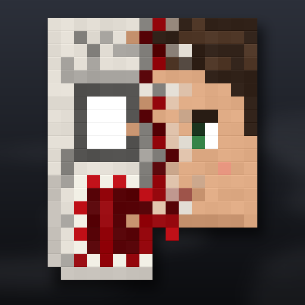
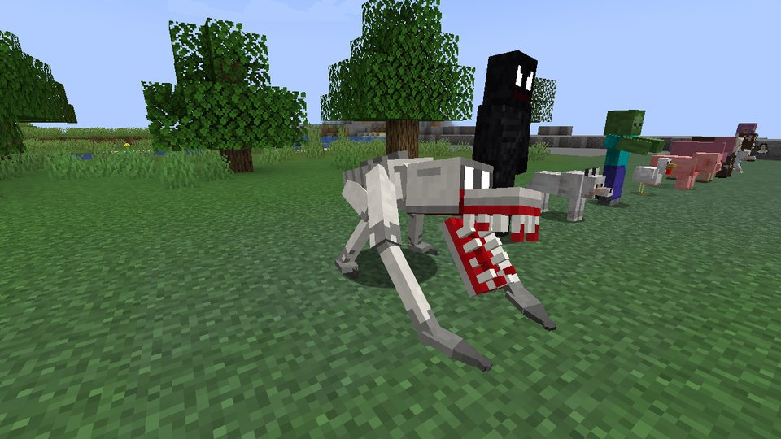
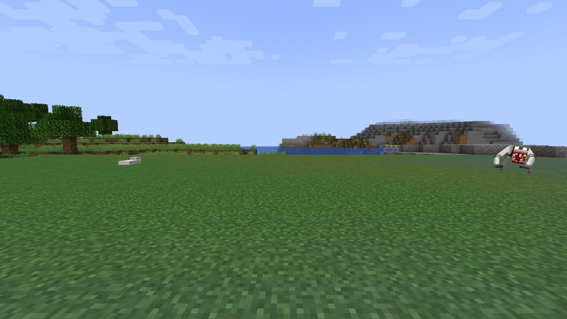
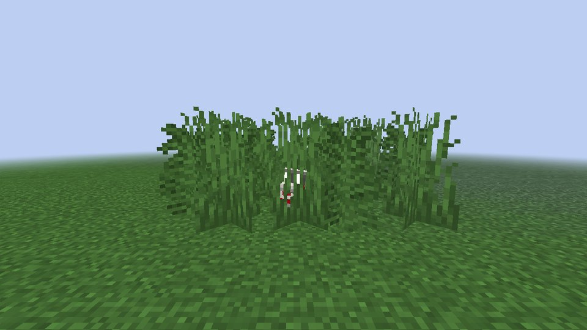
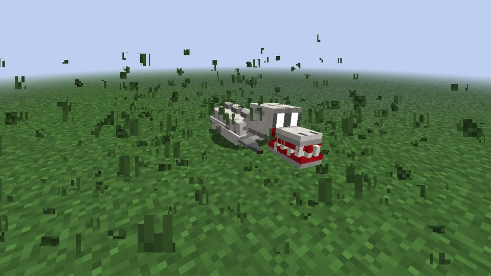
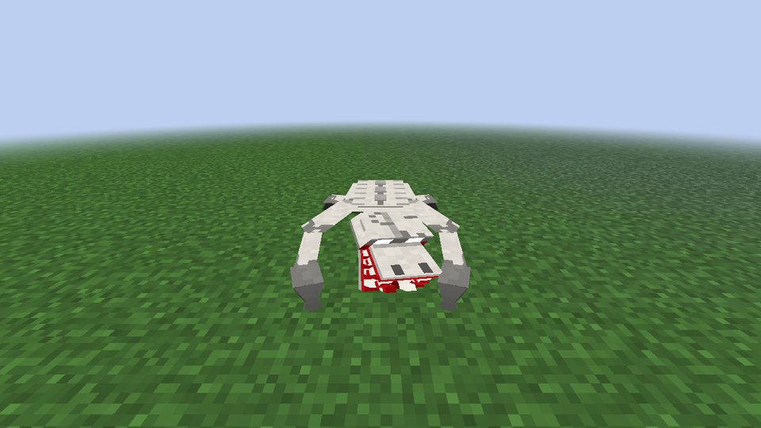
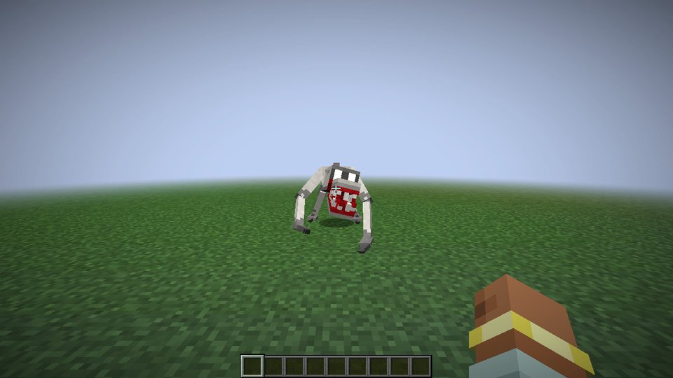

# Fog Lurker



A horror mod for **Minecraft 1.20.1 (Forge 47.x)**.

Something in the fog has been watching you play. It learns how you move and how you type. It learns what your friends sound like and what your dog is called. Then it uses all of that to lure you into the woods.


*Left to right: the Fog Lurker itself (the pale crawler), a wolf, a zombie, a chicken, a pig, a sheep, a cow, **your dog** (collar and name copied) and **your friend** (skin, armour and held item copied).*

## What it does

- **It wears your friend's face.** Two of you are playing and one goes off to chop wood. The creature takes the absent player's skin, armour and held item, plus their name tag and team colour. It walks up to the other player from the direction the real friend went, so it looks like them coming back.
- **It talks like them.** It writes in chat as `<YourFriend> ...`, copying how that person types: lowercase or not, punctuation, slang, "u" for "you", and sometimes word-for-word things they really said. With a Gemini API key it holds a real conversation: ask "where are you?" and it answers in their style.
- **It sounds like them.** With [Simple Voice Chat](https://modrinth.com/plugin/simple-voice-chat) installed, it plays short snippets of the friend's real voice from where it stands. It also splices snippets into sentences they never said. This only happens for players who opted in (see [Voice snippets](#voice-snippets-opt-in)).
- **It kills time like them.** While it waits for you it holds the tool they use most and "mines" a block, cracks and all. Then it stops halfway, goes completely still, and stares. Before you can even see it, you may hear their voice calling from the trees.
- **It behaves like them.** It copies their crouch-spam greeting, bunny hopping, sprint habits, idle swings, how far they stand from friends and how much they look around. All of this is learned by quietly watching each player.
- **It lures you into the woods.** It finds the thickest tree cover nearby (away from the real friend), walks you there and waits when you fall behind. If you stop following, it gets impatient in chat.
- **It hides among animals.** It can be a cow, sheep, pig, chicken, wolf or zombie in a real herd. It wanders the way the real animals around you wander (it learns that too), but stares at you a little too often and creeps closer when you look away.
- **It can be your dog.** It copies your tamed wolf's collar colour and name tag. It runs up to you, whines, then runs toward the trees and looks back, the way a dog that "found something" would.
- **It watches.** Sometimes it is just itself, the pale crawler, crouched at the edge of your vision and staring. Look at it too long and it is gone.
- **The fog rolls in** while it hunts you. When it reveals itself the screen shakes and you hear a heartbeat.


It can be killed, but it takes a lot (see Killing it below), and then it is gone for 30 minutes.

## What it really looks like

The Fog Lurker's real shape is **the pale crawler**. When it stops pretending, its stolen shape flickers and peels away into it. The crawler is pale and albino with gray accents. It moves on all fours, with arms long enough to reach more than a block past its shoulders and grasshopper legs whose knees sit up by its ribs. Its long jaw hangs open, showing a blood-red mouth full of teeth with blood on them, and its eyes are pure white and glow in the dark.

| Front | Side |
|---|---|
|  |  |

## Hauntings

Between appearances (after the grace period) one player gets a small scare every minute and a half to four minutes. They get rarer the longer a session goes on (up to 2.5 times further apart after about a dozen), so they stay unsettling instead of routine. None of these can hurt you.

- **Sounds only you can hear.** Footsteps coming up behind you. Footsteps crossing your roof. A chest in your base opening and closing. Something mining in the wall beside you underground.
- **The edge of your vision.** It crouches at the edge of your screen. The moment you turn to look straight at it, it is gone without a sound. (It only ever exists on your own screen.)
- **A torch goes out.** An ordinary torch you are not looking at is put out and drops as an item. Never a soul torch.
- **A friend who is not online.** "Alex joined the game", a line of chat in Alex's typing style, and later "Alex left the game". Alex was never there. (Check the player list.) Off when the server sets `impersonateInChat = false`.
- **A book in your chest.** Signed with your own name, quoting things you said in chat, and telling you where you sleep. With a Gemini key its last page is written in your own typing style. At most one every 20 minutes, only at your base.



## It knows where you are

- **Out in the open** it uses the woods, as before.
- **In a cave or mine** it waits in the darkest spots it can find, away from your torchlight, and a watcher stands at the end of the tunnel rather than far away.
- **At home** it learns where you live (your bed, or wherever you open chests the most). When you are indoors, a watcher appears right outside, 5 to 16 blocks away, where you can see it through a window or an open door.
- **It hides in tall grass and bushes.** When it watches you as itself it slinks to the thickest tall grass, ferns or leafy bush nearby and lies down in it like a dog, legs tucked under, with only its eyes showing. Its hitbox lies down too.
- **Spotted in its real shape, it does not run.** It flops flat on the ground like a pancake, lies there a moment, and is gone.

| Lying in the grass | Lying down (grass cleared) | Flopped |
|---|---|---|
|  |  |  |

## Killing it

It can be killed. Its health depends on the mode:

| Mode | Health |
|---|---|
| Very Easy | 50 hearts |
| Easy | 75 hearts |
| Medium | 100 hearts |
| Hard | 125 hearts |
| Deathwish | 175 hearts |

It has 4 armour points (2 armour icons), and it does not take fall, suffocation, drowning, fire, lava, cactus or freezing damage. Swords, arrows, tridents, explosions and Harming potions hurt it normally (it is not undead, so Healing heals it). A raised shield stops one bite, then its teeth wrench the shield aside for 5 seconds, like an axe (the Deathwish bite goes straight through shields). When it dies it falls in its real shape, and **for 30 minutes nothing happens** (world time: on a server it keeps counting while nobody is online, like the fear, peace and bell timers below): nothing appears on its own and nothing haunts anyone on the server (`/foglurker spawntimer` shows how long; admin spawn commands still work). Any other creature that was out leaves too. `/kill` still just makes it vanish (no drops, no rest).

### What it drops (only when a player lands the killing blow)

| Mode | The Fog of the Day / Night | Teeth of the Lurker | Foggy Stick | Ingot of the Fog |
|---|---|---|---|---|
| Very Easy | 25% | 15% | 4% | 1% |
| Easy | 40% | 25% | 7% | 2% |
| Medium | 60% | 40% | 10% | 3% |
| Hard | 75% | 60% | 14% | 4% |
| Deathwish | 75% | 75% | 18% | 6% (1.5x Hard) |

No drop is ever more than 75% likely.

It drops **The Fog of the Day** if it died in daylight and **The Fog of the Night** if it died at night (1-2 of them, 2-3 on Deathwish).

### The Protector of the Fog

Crafted in a crafting table:

| | | |
|---|---|---|
| Teeth of the Lurker | Ingot of the Fog | Teeth of the Lurker |
| Teeth of the Lurker | Ingot of the Fog | Teeth of the Lurker |
| Teeth of the Lurker | Foggy Stick | Teeth of the Lurker |

A spiky black, grey and white blade wrapped in a slowly drifting mist. **It cannot be enchanted** (not at a table, not with books).

- Against anything else it is just a wooden sword.
- Against the Fog Lurker a fully charged hit does **10 damage**, a critical hit **15**, straight through its armour (even a copy of your own enchanted armour it is wearing while it pretends to be you).
- **Right-click: a scare burst** (once every 2 seconds; it uses a charge and makes it fear you even if nothing is in reach). A blue sonic boom like the Warden's. It reaches every creature that is hunting you or is within 96 blocks, **wherever you aim**. 3 times in 4 it shrieks and flees. Otherwise it holds on but is weakened for 15 seconds: slower, its bites do 40% less and the gaps between them are 50% longer, and it glows so you can see it.
- After a scare burst it **fears you for 20 minutes**: it is half as likely to attack you, and if you are with a friend (within 16 blocks) it almost never attacks (a tenth as likely). Friends standing with you when you use it are feared too.
- It holds **10 scare bursts** (the durability bar). Hitting things never wears it out, and it cannot be repaired with planks or merged with another Protector on an anvil (renaming is fine).
- **Recharging:** put the sword in the **middle** of a crafting table and The Fog of the Day or The Fog of the Night in the slots around it. **Each fog item gives back one burst**, so you can put them in one at a time; day and night both work. One item per slot is used per craft (a stack in one slot gives one burst and the rest stays in the grid). If you put in more fog than it is missing, nothing is crafted until you take the extra out, and Mending (only possible with commands) does not refill it.

## How to survive it

Ordinary armour maths does not apply to its bite. Only good armour helps, by its own table (below). You can kill it (see above), but mostly you survive by knowing its rules.

**Armour against its bite** (a full set; a mixed set gives the average of its four pieces):

| Armour | Bite blocked |
|---|---|
| none, leather, chainmail | 0% |
| copper (from mods / newer versions) | 10% |
| iron (and a turtle helmet) | 25% |
| gold | 30% |
| diamond | 45% |
| diamond, Protection IV | 50% |
| netherite | 65% |
| netherite, Protection IV | 70% |

Protection IV adds 5% only on diamond and netherite; lower Protection levels, and Protection on any other armour, do nothing against it. Resistance potions still help as normal, except against the Deathwish bite, which no potion stops (a Totem of Undying still does).

**Its bite goes into your leg.** Every bite gives **Slowness I for 10 seconds** on every mode. On **Hard and Deathwish** it also gives **Mauled** for 10 seconds: **you cannot jump (no riptide launches either) and you cannot get into a boat**, and if it bites you while you sit in a boat on land it drags you out (a boat that is afloat is left alone: water is still your way out). Run *before* it reaches you; once it has your leg, boats and pillar-jumping are off the table until Mauled wears off (walking into water still works). A horse you are already riding can still jump for you. Milk clears both.

| What | Effect |
|---|---|
| **Water** | It cannot swim. Get in water or a boat and it can only pace the shore; after 20 seconds it gives up. |
| **Soul fire** | A soul torch, soul lantern or lit soul campfire protects everyone within 6 blocks. It will not shed its disguise there, will not come inside the circle, and cannot hit you. It circles outside and gives up after 20 seconds. (Soul sand comes from the Nether, so this is something you earn.) |
| **Bells** | Ring a bell (by hand, or by hitting it with an arrow, snowball or other projectile) and anything within 32 blocks flees. **It learns:** for 15 minutes after a bell drives it away from you, bells do nothing against it ("The bell rings out... nothing runs this time."). |
| **Do not look at it** | While it hunts you, looking at it makes it charge 25% faster. Looking away slows it to walking pace (a fast walk on Deathwish), so you can outrun it, if you can stand running blind and listening to it behind you. |
| **Deepslate and obsidian** | It cannot break them. |
| **Totem of Undying** | Still works, even on Deathwish. |

**Every escape makes it angrier.** Each time you get away from an attack (water, soul fire, a bell, or logging out or closing the world mid-attack) it becomes 10% more likely to attack you the next time it appears, up to +30%. The grudge resets the moment it lands a bite on you.



The edges of your screen darken and a heartbeat gets faster and louder the closer it is.

## You cannot hide from it on a tower or in a bunker

- **It climbs.** In its attacking form it climbs any wall it runs into, like a spider. If you pillar up, it climbs your tower and gets you at the top.
- **It follows you down.** It takes no fall damage, so it drops straight into the hole you dug.
- **It breaks in.** If you wall yourself in or seal the hole above you, it claws through: forward (two blocks high), down or up toward you. You see crack marks while it works, and harder blocks take longer (dirt about 1 s, stone about 1.7 s, iron about 4 s).
- **Except protected blocks.** It never breaks anything in the `foglurker:unbreakable` block tag: all deepslate (bricks, tiles, ores, stairs and so on), obsidian, crying obsidian, bedrock, reinforced deepslate, netherite blocks, ancient debris, respawn anchors, portals and portal frames, spawners, barriers and command blocks. It also skips anything as hard as obsidian or harder, and anything with an inventory or other data (chests, furnaces, beds, shulker boxes...). **A deepslate or obsidian bunker keeps it out.** Server owners can add blocks to the tag with a data pack.
- It respects the `mobGriefing` gamerule and the `breakBlocks` config option, plus claim/protection mods that block mobs from breaking blocks through Forge's `LivingDestroyBlockEvent` (the torch-snuffing haunting asks them with a block-break event from a fake player, which claim mods keep out too).

## Water is its weakness

- **It never appears in, on or next to water.** Every spawn spot, and the "woods" it leads you to, is checked to be dry ground.
- **In human form it swims like a player**, sprint-swimming flat through the water to cross rivers.
- **The crawler cannot swim.** It will not path into water. If it ends up in water it sinks, thrashes toward the shore, takes damage, and after three seconds the water drives it away.
- **Jump in water to escape.** If you are swimming, wading out of reach or in a boat, the crawler can only pace the nearest shore and scream. After 20 seconds it gives up. It also never sheds its human skin while you or it are in water, because it knows.


## Groups

When players are together (within 24 blocks of each other) it picks its victim inside the group: usually the one with the **least health** (about half the time), otherwise usually the one on the **edge of the group**, furthest from the others and closest to the dark it comes from (about 40%), and now and then anyone.

Once it is attacking, most of the time it switches to whoever is easiest: someone **much closer** to it than its target, or someone **3+ hearts weaker** who is not much further away. It only switches to players it could actually reach (not in water, not inside a soul-fire ward). A few are fixated and never switch.

## AFK

It leaves players who are away from the keyboard alone: it never comes for them, never attacks them, and no hauntings happen to them. If it is already out there when its target goes AFK, it leaves.

- **Automatic:** 5 minutes without doing anything (config `afkMinutes`) and you are AFK.
- **`/afk`** (or `/AFK`): AFK right now, without waiting. Type it again to come back. It is refused while it is already hunting you, so it cannot be used to escape.
- **Coming back:** anything you do ends it: looking around, walking, swimming, climbing, steering a horse or boat, sneaking, chatting, breaking, placing, using items or attacking. Things that happen *to* you do not count: knockback, water currents, riding a minecart, respawning or being teleported.
- When you go AFK, everyone sees **"*name* went afk"** in chat, and **AFK** stays above your hotbar until you are back. AFK players also show **[AFK]** after their name in the player list (Tab).
- Operators cannot send it after an AFK player with `/foglurker spawn` or `force` either; the command says so.
- Server owners can turn all of this off with `afkProtection = false`.

## The fog

The fog rolls in whenever it is near you and lifts a few seconds after it leaves. It works the same at **every render distance from 2 to 32 chunks**:

| What it is doing | How far you can see |
|---|---|
| a copy walking up from far off | about 120 blocks, or 80% of your view if that is shorter |
| stalking you | about 80 blocks, or 63% of your view |
| luring you deep | about 30 blocks, or a third of your view |
| attacking | about 11 blocks (7 at a 2-chunk render distance) |

So a long render distance cannot push the fog out of sight, and a short one still gets visibly foggier at every stage. The attack fog closes in over about 2 seconds. The same fog is also drawn as a soft veil over the screen (under your hotbar and chat), so it still shows if a shader pack or rendering mod replaces Minecraft's own fog. (Like the hotbar, the veil hides with F1.)

## Night

**The fog is thicker at night:** +10% on Very Easy, +15% Easy, +25% Medium, +35% Hard, +50% Deathwish.

**Deathwish only: the night meeting.** On Deathwish, at night, out in the open, about 3 in 10 of its appearances are a meeting: you walk straight into it. It stands a few steps in front of you, stares, and says:

> fogstalker: hello *yourname*
> fogstalker: please dont run
> fogstalker: i will not hurt you

It is a coin flip whether it means it. It is less likely to mean it for each time you got away from it before (+10% per escape, up to +30%, like any attack), more likely if it fears you after a scare burst, and on Peaceful it always means it. If it does, it sinks flat into the ground and is gone. If not:

> fogstalker: just kidding
> fogstalker: **RUN!**

**RUN!** also flashes above your hotbar. You get a **5 second head start**, then it comes, and **if it catches you, the bite takes a whole health bar** (good armour leaves you a little; a Totem of Undying saves you). If you get away (outrun it, water, soul fire, a bell, a scare burst from the Protector, or through a portal), it leaves you alone: **nothing comes for you on its own for 15 minutes**. Like the scare-burst fear and the bell cooldown, this is saved with the world, so quitting and coming back does not reset it. Try it with `/foglurker force meet [player]`.

## The five modes

| Mode | Attacks on | Damage per hit | Time between hits | Grace period (first start) | Notes |
|---|---|---|---|---|---|
| **Very Easy** | rarely (1 in 10 appearances) | 1 heart | 3 s | 45 minutes | mostly only watches |
| **Easy** | rarely (1 in 5) | 3 hearts | 2.5 s | 30 minutes | |
| **Medium** *(default)* | 1 in 3 | 5 hearts | 2 s | 20 minutes (one Minecraft day) | |
| **Hard** | 1 in 2 | 6 hearts | 1.75 s | 10 minutes | |
| **Deathwish** | 3 in 4 | **a full health bar** (kills you unless your armour blocks some of it) | 1.5 s | 5 minutes | **50% faster** than every other mode; it screams and gives you 1.5 s before its first bite |

- It can never spam attacks: the time between hits is enforced on the creature itself.
- After a set number of hits in one appearance it leaves: 1 on Very Easy, 2 on Easy, 3 on Medium, 4 on Hard, no limit on Deathwish. So on Hard, an appearance can deal up to 24 hearts, enough to kill you from full health if you stand and take it.
- Without armour "5 hearts" really is 5 hearts; good armour blocks part of it (see the armour table). On Deathwish a bite deals a whole health bar: unarmoured you die, in iron you are left with 2.5 hearts. A Totem of Undying still saves you.
- Every bite gives Slowness I for 10 s. On Hard and Deathwish it also gives Mauled for 10 s: no jumping, no boats.
- Deathwish kills in one bite, so it always announces itself: a deep scream when it starts hunting, then 1.5 seconds before it can bite.
- The grace period counts real play time from the very first time a world starts with the mod. Nothing appears during it, but it is already learning how everyone plays.
- **After the grace period it rolls every 5 minutes:**
  1. 5 minutes after the grace period ends there is a **50/50** chance it appears.
  2. If it did **not** appear, it is **guaranteed** to appear at the next roll 5 minutes later.
  3. If it **did** appear, the next roll is a normal 50/50 again.

  On a multiplayer server it can be after up to two players at once (`maxConcurrent`), but never two at once for the same player, and never straight back to someone it just left. With one player online the timer pauses while it is out hunting, and the next roll comes 5 minutes after it leaves. `/foglurker spawntimer` shows the time to the next roll and whether that roll is guaranteed.
- On vanilla Peaceful difficulty it never attacks, it only watches.
- `/foglurker naturalspawning off` stops it appearing on its own in that world, and stops the hauntings too; it then only comes when summoned.

## Commands

Minecraft commands use spaces, so `foglurker→spawn` is typed `/foglurker spawn`.

"op" means permission level 2 or higher (the singleplayer host counts too). Admin spawn and force commands are not limited by the rules for natural appearances: they work during the rest after a kill and can send a second creature to someone already hunted.

| Command | Who | What it does |
|---|---|---|
| `/foglurker spawn [player] [disguise] [attack\|watch]` | cheats / op | Spawns it now. Disguises: `player`, `dog`, `cow`, `sheep`, `pig`, `chicken`, `zombie`, `wolf`, `crawler` (itself), `random` |
| `/foglurker gracetimer` | everyone | Time left in the grace period |
| `/foglurker endgrace` | cheats / op | Ends the grace period right now (stays ended even if you switch to a mode with a longer one). The first spawn roll comes `spawnRollMinutes` (5 by default) later |
| `/foglurker force hide [player]` | cheats / op | The pale crawler appears, finds tall grass or a bush and lies down in it, watching. Never attacks |
| `/foglurker force stalk [player]` | cheats / op | The pale crawler creeps closer from hiding spot to hiding spot. Whenever you look at it, it drops flat and freezes. Stare it down and it leaves |
| `/foglurker force attack [player]` | cheats / op | The pale crawler appears nearby and hunts you immediately |
| `/foglurker force meet [player]` | cheats / op | The Deathwish night meeting, right now: "hello", "please dont run", "i will not hurt you"... and a coin flip whether it means it |
| `/foglurker naturalspawning [on\|off]` | view: everyone · set: op / host | Whether it appears on its own. `off`: it only comes when you summon it with `spawn` or `force`, and the hauntings stop too. Saved with the world. Turning it back `on` starts a fresh 5-minute countdown |
| `/foglurker spawntimer` | cheats / op | Time until the next spawn roll and whether it is guaranteed (or who it is hunting right now) |
| `/foglurker setgeminiapikey <key>` | op / singleplayer host | Saves the Gemini API key (encrypted) and tests it. `clear` removes it |
| `/foglurker difficulty [mode]` | view: everyone · set: op / host | `very_easy`, `easy`, `medium`, `hard`, `deathwish` (clickable) |
| `/foglurker geministatus` | op / host | Shows the masked key and tests it |
| `/foglurker despawn` | cheats / op | Sends it away (this never counts as you getting away) |
| `/foglurker-macarena [loops]` | cheats / op | The pale crawler appears in front of you and does the Macarena (default 3 loops, max 20), then vanishes. Harmless and invulnerable, never counts as a hunt. Also `/foglurker macarena` |
| `/foglurker debugeverything` | op / host | **Temporary.** Checks everything on the server *and* in your game, and lists what passed and failed in chat (see below) |
| `/flurk voicesnippets terms` | everyone | Shows the voice snippet terms with **[YES] [NO]** buttons |
| `/fglurk optin` | everyone | Opt in to voice snippets |
| `/fglurk optout` | everyone | Opt out **and delete every stored snippet** |
| `/fglurk voicesnippets status` | everyone | Whether you are opted in and how many snippets exist |
| `/afk` (or `/AFK`) | everyone | Go AFK now: it leaves you alone until you move or look around. Again to come back. Not while it is hunting you |
| `/fglurk chatlearning [on\|off]` | everyone | Whether it may learn how you type. `off` forgets every message it kept from you and keeps your chat out of what it sends to Gemini |

`/flurk` and `/fglurk` both work for every voice command.

### `/foglurker-macarena`


The pale crawler rears up on its hind legs and does the full 16-count dance with its far-too-long arms (its jaw chomps to the beat): arms out palm down, palms up, hands to the shoulders, behind the head, to the hips and to the back pockets, then a hip wiggle and a hop with a quarter turn, bouncing on every beat. The music is an original note-block groove, not the song.

### `/foglurker debugeverything` (temporary)


It runs dozens of checks and lists each one in chat with ✔ or ✘. It also plays a two-second fog and heartbeat test so you can see and hear the effects. The server results are also written to the server log.
- **Server side:** registration, damage types and tags, mod files, every mode's numbers (damage, time between hits, grace), a dry-run spawn of every shape near you (nothing actually spawns), refusal of nearby water, the hit cooldown, water rules, what it has learned about you, chat-style copying, voice chat status, the secure folder and its encryption, snippet storage, voice effects, and Gemini (with a live test if a key is set).
- **Your game:** renderer, crawler model, textures, sounds, language file, every disguise puppet and the swim animation.

**Removing it before release:** delete `src/main/java/com/foglurker/debug/`, `network/DebugPacket.java` and `client/ClientDebug.java`, the single `d.register(...)` line marked `TEMPORARY` in `command/FogLurkerCommands.java`, and the five-line `CHANNEL.messageBuilder(DebugPacket...)` block marked `TEMPORARY` in `network/ModNetwork.java`. The fog-event counters in `client/ClientEffects.java` only feed this command and can go too.

## Voice snippets (opt-in)

Nobody is ever recorded without opting in. `/flurk voicesnippets terms` shows exactly:

> by agreeing to these terms you allow for the mod to make small snippets of your voice and store it in a secure folder in your account/server settings

- **YES:** *great! you have now opted in use the command `/fglurk optout` to cancel it NOTE: this will delete all your voice snippets that have been stored*
- **NO:** *we are sad that you chose this if you want to opt in then use `/fglurk optin`*

How it works:
- Only while Simple Voice Chat is running. Each player sees a one-time notice on their first join pointing them to the terms.
- About a third of what an opted-in player says (configurable) is kept as a 0.6–6 second clip. Up to 40 clips per player are kept; new ones mostly replace the oldest.
- **Snippets expire.** If an opted-in player has not been online for 30 days (for example, they removed the mod and so can no longer join the server), their snippets are deleted automatically. If the whole mod goes unused for 30 days and is then started again, it deletes every snippet before doing anything else. A mod that has been removed cannot run any code, so the secure folder also contains a `READ_ME.txt` saying it is safe to delete by hand.
- **Opting out deletes right away.** If a clip cannot be deleted at that moment (for example, a virus scanner has the file open), the mod keeps trying: it is gone at the next check, within 10 minutes while anyone is playing, or at the next start.
- Clips play back through Simple Voice Chat from the creature's position, under their own **"Fog Lurker"** volume slider. They sound natural while it pretends, uncanny when it slips, and deep and distorted when it reveals itself.
- The voice is "replicated" by replaying and splicing your real recorded words with audio effects. No AI voice cloning is used, and **voice clips never leave the server**. Gemini only ever sees chat text.

## Gemini (optional)

Without a key the creature uses a built-in phrase system that still copies each player's typing style. With a key it writes its own messages and can answer when you talk to it.

1. Get a key at [aistudio.google.com/apikey](https://aistudio.google.com/apikey).
2. In game (as op, or the host of a singleplayer/LAN world): `/foglurker setgeminiapikey <your key>`.
3. It tests the key and tells you whether it works.

You can also set the `FOGLURKER_GEMINI_API_KEY` environment variable on a server (a key saved with the command takes priority). `/foglurker geministatus` shows the masked key, where it comes from, the models in use, whether Gemini is paused and why, and tests it.

How the key is handled:
- It is stored AES-256-GCM encrypted in `foglurker_secure/`, never in a world save, never sent to players, and never logged. Chat only ever shows a masked preview (`AIza…k3Fq`).
- It is sent only to Google, in the `x-goog-api-key` header (never in a URL), over HTTPS.
- If every model rejects the key it stops asking for 10 minutes (or until you set a key again) and uses the built-in phrases, so a bad key never slows the game down or spams requests. If a model is rate limited it skips that model for as long as Google asks (up to 10 minutes, from the reply or its Retry-After header) and uses the next one; a model that is missing, broken or refuses the request is skipped too.
- Every request has a time limit; if Google is slow or unreachable the creature simply uses a built-in phrase.
- Models are configurable (default `gemini-flash-latest`, falling back to `gemini-2.5-flash` and `gemini-flash-lite-latest`). Names like `models/gemini-2.5-flash` work too; anything that is not a valid model id is ignored with a warning.

What is sent to Google: the names of the two players involved, recent chat lines and the impersonated player's recent chat messages, to write each line in their style. Anyone can keep their chat out of it with `/fglurk chatlearning off`. Server owners can turn fake chat off entirely with `impersonateInChat = false`. Voice snippets are never sent anywhere.

## The secure folder

Everything sensitive lives in `foglurker_secure/` next to the game or server files. In singleplayer that is your `.minecraft` folder; on a server it is the server folder. It is **never inside a world save**, so sharing a world never shares it:

```
foglurker_secure/
  .master.key              random AES-256 key generated on first use
  gemini_api_key.enc       your Gemini key, AES-GCM encrypted
  voice_consent.json       who opted in (encrypted)
  voice_snippets/<uuid>/   each clip AES-GCM encrypted
  last_active.txt          when the mod last ran (for the 30-day cleanup)
  READ_ME.txt              says the folder is safe to delete by hand
```

On Linux and macOS the folder is restricted to the account running Minecraft (`chmod 700/600`). This protects against snooping, world downloads and accidental sharing. It does not protect against someone who already controls the machine.

What it learns about play style (movement habits, recent chat lines, your dog's name) is saved per world in `world/data/foglurker.dat`.

## Installing

1. Install **Minecraft Forge 1.20.1** (47.x).
2. Put `FogLurker-1.3.0.jar` in `mods/` on the **server and every client**. It adds an entity with its own renderer, so clients need it too.
3. Optional, for voices: install **Simple Voice Chat** for Forge 1.20.1 on the server and every client.

## Configuration

`config/foglurker-common.toml` (server side):

| Option | Default | |
|---|---|---|
| `defaultDifficulty` | `medium` | Mode for new worlds |
| `spawnRollMinutes` | 5 | Minutes between spawn rolls (a missed roll makes the next one guaranteed) |
| `spawnChance` | 0.5 | Chance a normal roll makes it appear. 0 = it never appears on its own in any world (no "guaranteed next roll" either) |
| `breakBlocks` | true | Let the attacking form break blocks to reach you (never the protected list) |
| `hauntings` | true | Small scares between appearances |
| `hauntingMinSeconds` / `MaxSeconds` | 90 / 240 | How often a haunting happens |
| `sabotage` | true | Let hauntings put out torches (also needs `breakBlocks` and mobGriefing) and leave books in chests |
| `wardRadius` | 6 | How far soul fire protects (0 turns wards off) |
| `eyeContactRule` | true | Looking at it speeds it up, looking away slows it down |
| `encounterMaxMinutes` | 5 | An appearance gives up after this long (a watcher that only stares leaves after 2 minutes at most) |
| `overworldOnly` | true | Only appear on its own in the Overworld |
| `allowDoppelganger` | true | When you are alone it can copy *you* |
| `minPlayerSeparation` | 48 | Players must be this far apart before it impersonates one to the other |
| `chatVisibility` | `TARGET_ONLY` | `EVERYONE` lets the impersonated player see their own fake messages too |
| `learnChat` | true | Remember recent chat lines to copy typing style (players can opt out with `/fglurk chatlearning off`). Off: nothing players type is kept or sent to Gemini |
| `impersonateInChat` | true | Let it send fake chat as a player (the mimic's lines and the "friend who is not online" haunting). Off: it still copies skins, voices and movement |
| `bellCooldownMinutes` | 15 | After a bell drives it off a player, bells do not work against it for that player for this long (0 = bells always work) |
| `escapeEscalation` | true | Each escape makes the next appearance 10% more likely to attack (up to +30%); a bite resets it |
| `maxConcurrent` | 2 | How many players it can hunt at the same time on a server |
| `afkProtection` | true | Leave AFK players alone (never comes for or attacks them) |
| `afkMinutes` | 5 | Minutes without activity before a player counts as AFK |
| `gemini.model` | `gemini-flash-latest` | Plus `fallbackModels`, `timeoutSeconds` |
| `voice.maxSnippetsPerPlayer` | 40 | |
| `voice.recordChance` | 0.35 | |
| `voice.voiceDistance` | 32 | |
| `voice.showVoiceNoticeOnJoin` | true | |

`config/foglurker-client.toml`: `fogEffects` (the fog), `screenEffects` (shake and vignette), `fogOverlay` (also draw the fog as a see-through layer over the screen, so it shows even when a shader pack or rendering mod replaces Minecraft's fog; on by default), `discordRichPresence` (Discord Rich Presence, below; on by default).

**Discord Rich Presence.** While the game runs, your Discord profile shows **Playing Fog Lurker**, with "In the menus", "Lost in the fog" or "Being hunted...", single- or multiplayer, and how long you have been playing. It works with the Discord app (including Flatpak and Snap installs) and with Vesktop. It only talks to the Discord app on your own computer, and it never shows a server address, a world name or anyone's name. If Discord is not running, nothing happens. Turn it off with `discordRichPresence = false`. Your online status (Do Not Disturb and so on) stays yours to set in Discord: apps cannot change it. `/foglurker debugeverything` checks whether the world fog is working on your game.

## Versioning

Jars are named `FogLurker-<version>.<features>.<patch>.jar`, for example `FogLurker-1.3.0.jar`:
- **version** (the first number) is 1;
- **features** goes up by one whenever something new is added (and patch starts again at 0);
- **patch** goes up by one for every release that only fixes bugs.

The number lives in `mod_version` in `gradle.properties`.

## Building from source

Requires Java 17.

```bash
./gradlew build               # -> build/libs/FogLurker-1.3.0.jar
./gradlew runGameTestServer   # boots a real server and runs the in-game tests
```

The in-game tests (`src/gametest`, never shipped in the jar) check:
- every disguise spawns and its AI runs
- a mimic copies the far-away friend's skin and name, walks up, greets and starts luring
- a zombie disguise stalks, transforms, chases and lands exactly 5 hearts on Medium
- each mode's damage is exact without armour, every armour type blocks exactly its share (leather/chainmail 0, iron 25, gold 30, diamond 45, netherite 65, Protection IV only on diamond/netherite), and a Deathwish bite kills unarmoured but not in iron
- grace times, commands, encryption, tamper detection, consent and opt-out deletion
- typing-style copying
- hits are spaced exactly by the mode's cooldown (Very Easy: blocked at 1.5 s, allowed at 3 s)
- water: spawn spots refuse water, the crawler will not path into it, and a crawler thrown in is driven off
- the spawn rolls: 50/50, a miss guarantees the next, a hit resets to 50/50; a 0% chance never spawns; `/foglurker naturalspawning off|on` is op-only, survives a save and restarts the countdown
- it climbs a 6-block deepslate tower to reach you, digs into a stone shelter, and cannot get into a deepslate one
- soul fire keeps it out of reach until the torch is removed; a bell makes it flee
- AFK: 5 minutes of nothing makes you AFK (4:58 does not), knockback does not end it but looking around does, /afk and /AFK work at once and survive the jiggle of closing chat, /afk is refused mid-hunt, an AFK player is never picked, force commands refuse AFK players, and respawning does not end AFK
- the fog at every render distance from 2 to 32 chunks: always visibly closer than your normal view, never further for thicker fog, attack fog within about 12 blocks, and it eases in without popping
- a summoned creature stays the pale crawler, a flopped one has a flat hitbox, looking for dry ground never loads a chunk, a grace period that has run out stays over, and voice snippets with no opt-in on record are deleted at start-up
- the bite: Slowness I for 10 s on Easy; on Hard also Mauled, which cancels jumps, refuses boats and drags you out of the one you sit in, and both work again once it wears off
- Deathwish cannot bite during its 1.5 s wind-up, then kills
- a second bell within the cooldown does nothing, escaping with a bell adds +10% (capped at +30%), and a bite resets it
- it never hunts one player twice at once and does not come straight back to the player it just left
- groups: it picks the hurt player about half the time and the one at the edge about 40% of the time; mid-attack it switches to a much closer player and bites them, not the far one
- night: the fog multipliers per mode; the night meeting waits out "RUN!" and the full 5 second head start, then kills in one bite; when it means it, it leaves without a scratch; getting away gives 15 minutes of peace, which is saved with the world
- killing it: 50/75/100/125/175 hearts per mode; ordinary hits are softened by its hide; the Protector does exactly 10 (15 on a critical hit), even through Protection armour it copied; a kill sends every other creature away and rests it for 30 minutes, which survives a restart; nothing drops unless a player lands the killing blow; while it flops away not even a creative player can hurt it; each mode's drop rates come out as listed (the stick never rarer than the ingot, the Deathwish ingot 1.5x Hard, the fog matching day or night) and none passes 75%
- the Protector: hits like a wooden sword and never wears out from hitting; a scare burst uses one charge, reaches the creature hunting you, and either scares it off or weakens it; you and friends next to you are feared, a far player is not; an empty sword cannot burst; recharging works one fog item at a time, only with the sword in the middle, and never takes more fog than it is missing; it cannot be enchanted or merged on an anvil (renaming works); the 3x3 sword recipe is exact
- `/fglurk chatlearning off` forgets your messages, drops them from the Gemini context, stops learning, and survives a restart
- the Gemini client against a fake Gemini server: falls back past missing (404), forbidden (403), refusing (400), broken (502) and rate-limited (429) models; only pauses the key when every model refuses it; retries without the thinking budget once and remembers it; stops at once on an invalid key and pauses (10 minutes, or until a key is set again); waits as long as Google asks after a rate limit; reports safety blocks and empty replies; never sends a malformed key; times out on a hung server; the key is only ever in the header; replies are cleaned of formatting codes, invisible characters and split emoji
- hauntings: only the unseen ordinary torch goes out, a signed book lands in your chest once, an offline friend "joins", home tracking follows beds and chests
- indoors at home the watcher appears outside your roof; spotted in its real shape it flops flat
- `/foglurker endgrace` and `/foglurker force hide|stalk|attack` work and are cheats-only; it finds tall grass, lies down with a low hitbox, drops flat when looked at while stalking, and attacks on command
- voice snippets of a player unseen for 31 days are deleted, a player seen yesterday keeps theirs, and a mod unused for 31 days wipes everything on start
- `/foglurker-macarena` is cheats-only, spawns one harmless dancer that turns on count 16 and leaves after its loops
- `/foglurker debugeverything` runs end to end

`./gradlew runClient -PfoglurkerShowcase` (with a world named `FogShowcase`) lines up every shape and saves screenshots (the ones in this README) to the game's `screenshots` folder. Add `-PfoglurkerScene=snow` to find a snowy mountain and photograph it hiding as a wolf next to its real form (`foglurker_snow_*.png`). The textures and the split-head logo are generated by the scripts in `tools/`.


## Known limits

- Information mods such as Jade or WTHIT will name it "Fog Lurker" when you look at it.
- If the impersonated player comes close enough to see their double, it disappears. It is never caught standing next to the original.
- Fake chat lines are server messages formatted like player chat. Players who look very closely at chat-trust indicators may notice.
